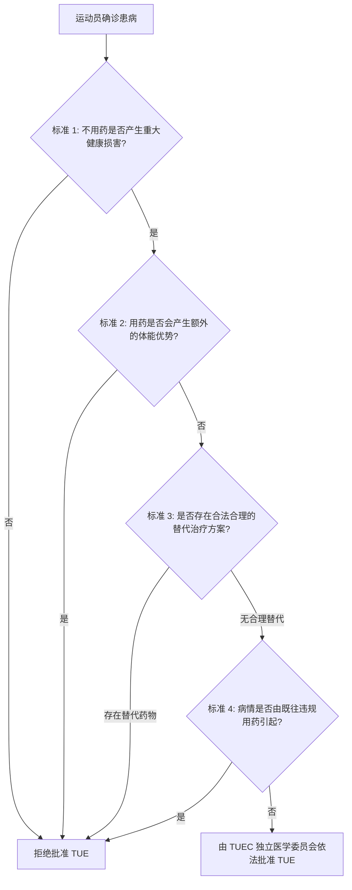

# ISSF 反兴奋剂规则：禁用清单与治疗用药豁免标准 (ADR Article 4 & ISTUE)

> **标准依据**：本规则依据国际射击运动联合会《ISSF 反兴奋剂规则》（2026 版）**ADR Article 4 (The Prohibited List & Therapeutic Use Exemptions)**、世界反兴奋剂机构（WADA）最新《禁用清单国际标准》（*International Standard for the Prohibited List*）及《治疗用药豁免国际标准》（*International Standard for Therapeutic Use Exemptions, ISTUE*）编制，深度解析射击运动禁用物质分类、**P1 类 β-受体阻断剂专项全时段禁用规定**及 TUE 申请与审批法理准则。

---

## 一、 WADA 禁用清单架构与射击项目专项管控 (The Prohibited List & Shooting Special Rules)

### 1. 禁用清单的法律效力与更新机制
* **年度更新**：WADA 每年发布更新版《禁用清单》，通常于每年 10 月 1 日前公示，并于次年 1 月 1 日起全球强制生效；
* **列入标准**：当一种物质或方法满足以下 **三项条件中的两项**，或存在掩盖其他违禁品风险时，即被列入清单：
  1. 具有增强或潜在增强运动表现的能力；
  2. 对运动员健康构成实际或潜在的健康风险；
  3. 违背体育精神（The Spirit of Sport）。

### 2. 射击运动核心专项禁用：P1 类 β-受体阻断剂 (Beta-Blockers)
* **管控级别：全程全时段禁止（In- and Out-of-Competition）**
  * 在绝大多数奥运项目中，β-受体阻断剂仅在“赛内”禁止；但在 **射击运动（ISSF 所有手枪、步枪、飞碟及移动靶项目）中，β-受体阻断剂属于赛内与赛外（全时段）绝对禁止**。
* **禁用机理与竞技危害**：
  * β-受体阻断剂（如普萘洛尔 Propranolol、阿替洛尔 Atenolol、比索洛尔 Bisoprolol 等）能够显著降低心率、减小血压波动、抑制中枢与外周交感神经兴奋性，并**彻底消除生理性肌肉震颤（Tremor）**，从而在瞄准稳定性与击发控制上形成极其显著且不公平的竞技优势。
* **持有与使用即违规**：射击运动员在任何时间（包括休赛期与赛外日常训练）体内检出或持有此类药物，均直接构成严重兴奋剂违规。

---

## 二、 禁用物质与禁用方法分类全解 (Substances & Methods Classification)

### 1. 全时段禁用物质与方法 (At All Times - In- and Out-of-Competition)
* **S0. 未经批准的物质 (Non-Approved Substances)**：未获任何国家政府卫生监管机构批准用于人体治疗的临床前/临床试验阶段药物；
* **S1. 蛋白同化制剂 (Anabolic Agents)**：如类固醇（睾酮 Testosterone、诺龙 Nandrolone 等）；
* **S2. 肽类激素、生长因子及相关物质 (Peptide Hormones & Growth Factors)**：如促红细胞生成素（EPO）、人类生长激素（hGH）等；
* **S3. β2-受体激动剂 (Beta-2 Agonists)**：所有选择性及非选择性 β2-激动剂（按治疗剂量吸入特定剂量的沙丁胺醇 Salbutamol、福莫特罗 Formoterol 等除外，超量需 TUE）；
* **S4. 激素和代谢调节剂 (Hormone and Metabolic Modulators)**：如芳香化酶抑制剂、他莫昔芬、胰岛素、曲美他嗪、美度铵（Meldonium）等；
* **S5. 利尿剂和掩蔽剂 (Diuretics and Masking Agents)**：如氢氯噻嗪、呋塞米等（其不仅掩盖其他违禁品，在射击中亦可能被用于快速降重或调整生理状态）；
* **M1 – M3. 禁用方法 (Prohibited Methods)**：
  * **M1**：血液及血液成分操纵（如自体/异体输血）；
  * **M2**：化学和物理操纵（调换样本、静脉输液或注射在 12 小时内累计超过 100 mL，医疗急救除外）；
  * **M3**：基因与细胞兴奋剂。

### 2. 仅在赛内禁用的物质 (In-Competition Prohibited)
* **S6. 刺激剂 (Stimulants)**：如可卡因、安非他命、麻黄碱等；
* **S7. 麻醉剂 (Narcotics)**：如吗啡、羟考酮、芬太尼等；
* **S8. 大麻（酚）类 (Cannabinoids)**：天然或合成大麻素（大麻二酚 CBD 除外，但需警惕产品污染风险）；
* **S9. 糖皮质激素 (Glucocorticoids)**：所有通过口服、直肠、静脉或肌肉注射等全身途径使用的糖皮质激素。

### 3. 特定项目全时段禁用物质 (Prohibited in Particular Sports)
* **P1. β-受体阻断剂 (Beta-Blockers)**：**ISSF 射击运动赛内及赛外全程禁用**。

---

## 三、 治疗用药豁免 (TUE) 核心法定准入标准 (ISTUE Criteria)

根据 WADA《治疗用药豁免国际标准》（ISTUE）第 4.2 条，运动员申请 TUE 必须**同时满足以下四项严苛法定标准**，缺一不可：



1. **不可替代的健康损害 (Significant Impairment to Health)**：如果不使用该禁用物质或方法，运动员在急性或慢性疾病治疗过程中将遭受重大的健康损害；
2. **仅限恢复正常生理状态 (No Additional Performance Enhancement)**：使用该药物仅能使运动员恢复至正常健康水平，**绝不能产生超出正常生理状态以外的竞技表现增强**；
3. **无合理合法替代疗法 (No Permitted Therapeutic Alternative)**：不存在其他未列入禁用清单的合理治疗替代方案，或经临床证实合理替代药物疗效不佳/存在严重不良反应；
4. **非既往违规用药之后遗症 (Not a Consequence of Prior Doping)**：需要使用该物质的病因，不得是由于既往在无有效 TUE 情况下使用违禁品所致。

---

## 四、 ISSF 国际级运动员 TUE 申请与审批全流程

### 1. 管辖权归属判定
* **国际级运动员（含 ISSF RTP/TP 人员及国际赛事参赛者）**：必须直接向 **ISSF / 国际检查机构（ITA TUE Commission）** 提交申请；
* **国家级运动员**：向所属本国国家反兴奋剂机构（NADO）提交申请；若后续入选参加 ISSF 国际赛事，须提前向 ISSF 申请**TUE 跨机构互认（Recognition）**。

### 2. 申请时限与前置要求
* **提前 30 天申报原则**：除紧急抢救情况外，常规 TUE 申请必须在**参加国际比赛或开始用药前至少 30 天**提交；
* **病历证据链要求**：必须附带由专科主治医师出具的完整、清晰的综合医疗档案（包括明确的临床诊断、详细病史记录、客观体检结果、化验单、影像学或心电图等客观医学检测报告）。

### 3. 系统填报路径
* 申请须统一通过 WADA 的 **ADAMS 系统（Anti-Doping Administration and Management System）** 线上提交至 ISSF/ITA TUE 委员会。

---

## 五、 追溯性 TUE (Retroactive TUE) 与双向互认机制

### 1. 追溯性 TUE 的严苛适用情形 (ISTUE Article 4.1)
仅在以下极少数法条明确列举的例外情况下，方可事后补办追溯性 TUE：
* **紧急医疗抢救或急症发作**：因生命垂危或突发急症必须立即给药，客观上无法提前申报；
* **时间紧迫不可抗力**：在接受检查前，因特殊突发情况导致没有充足时间提交申请或审评；
* **特殊公平原则（Article 4.3）**：经 WADA 及 ISSF 共同认定，基于公平与人道主义原则拒绝给予追溯性豁免将显失公允的情形。

### 2. TUE 互认与争议解决
* **NADO 批件的 ISSF 自动/申请互认**：持有国家反兴奋剂机构有效 TUE 的运动员被提名为国际级运动员后，须在 ADAMS 系统中将该批件提交 ISSF 审核互认；
* **争议仲裁**：若 ISSF 拒绝承认 NADO 批发的 TUE，运动员或所属 NADO 可向 **WADA TUE 争议上诉委员会** 提起审查；对 WADA 裁决仍不服的，最终向 **国际体育仲裁院（CAS）** 提起上诉。

---

## 六、 禁用类别与 TUE 申请要素对照表

| 禁用物质/方法类别 | 射击运动管控时段 | TUE 申请核心医学要件 | 违规法律风险与判定 |
| :--- | :--- | :--- | :--- |
| **P1. β-受体阻断剂**<br>*(普萘洛尔、阿替洛尔等)* | **赛内 + 赛外<br>(全程全时段禁止)** | 需提供确凿的心血管专科器质性病变证据及其他非禁用降压/抗心律失常药物无效的详实病历 | 未获 TUE 阳性检出直接面临 **2 至 4 年禁赛**，并取消全部相关比赛成绩 |
| **S1. 蛋白同化制剂**<br>*(类固醇、睾酮等)* | **赛内 + 赛外<br>(全程全时段禁止)** | 原发性或继发性性腺功能减退症的内分泌专科确诊记录与长期激素水平监测单 | 属于严重违禁品，顶格起步判处 **4 年禁赛** |
| **S3. β2-受体激动剂**<br>*(超出阈值的哮喘药)* | **赛内 + 赛外<br>(全程全时段禁止)** | 呼吸科肺功能检查（FEV1、支气管舒张试验或支气管激发试验阳性报告） | 超量使用未报批视为使用禁用物质违规 |
| **S5. 利尿剂和掩蔽剂**<br>*(氢氯噻嗪、呋塞米等)* | **赛内 + 赛外<br>(全程全时段禁止)** | 严重水肿或难治性高血压临床诊断证明，且须证明未与特定阈值物质混合使用 | 直接成立样本阳性违规（严格责任） |
| **S6–S9. 赛内禁用物质**<br>*(如糖皮质激素注射)* | **仅限赛内禁止** | 明确的关节腔/局部软组织炎症诊断、用药剂量及停药期医学记录 | 赛内检查阳性若无事前 TUE 即构成违规 |

---

> **官方依据、指引链接与参考文本**

> 1. **WADA 官方最新禁用清单在线检索与下载 (The Prohibited List)**：
   * 官方主页：[WADA Prohibited List Hub](https://www.wada-ama.org/en/prohibited-list)
   * 官方分类与检索工具：[WADA Prohibited List Mobile & Online Portal](https://www.wada-ama.org/en/resources/world-anti-doping-program/prohibited-list)
> 2. **WADA 治疗用药豁免指引与国际标准 (ISTUE Guidelines)**：
   * 官方指南：[WADA TUE Guidelines & Medical Information](https://www.wada-ama.org/en/what-we-do/therapeutic-use-exemptions-tue)
> 3. **ISSF / ITA 治疗用药豁免办理专区 (ISSF TUE Application via ITA)**：
   * ISSF 官方反兴奋剂专栏：[ISSF Anti-Doping Overview](https://www.issf-sports.org)
   * 国际检查机构（ITA）TUE 申请通道：[ITA TUE Online Platform](https://ita.sport/tue)
> 4. **仲裁说明**：本文件为官方禁用清单与 TUE 规则中文对照规范版；临床用药判定、批件有效性及剂量争议，一律以 WADA 最新英文《禁用清单》正本及《ISTUE 国际标准》为准。
```